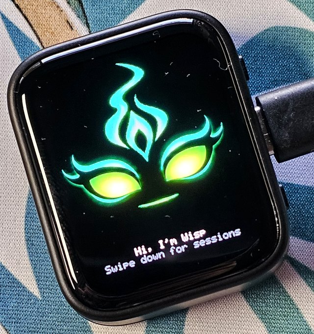
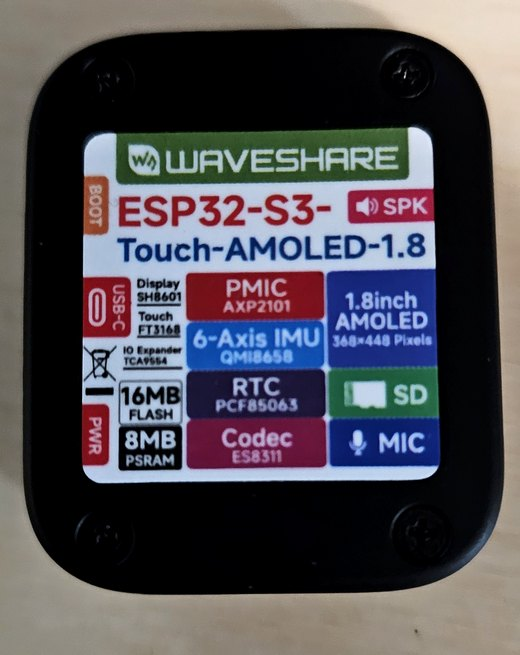
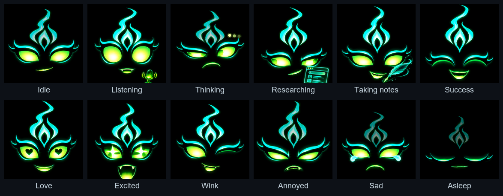
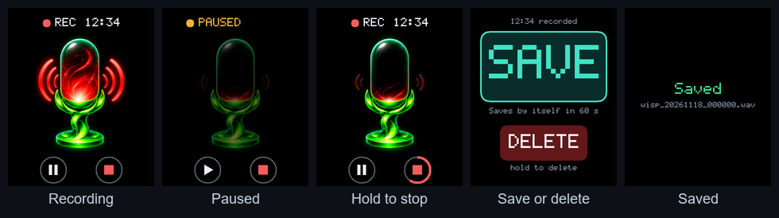
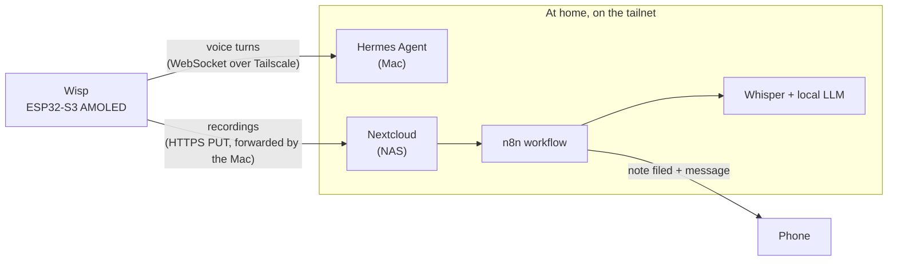

<p align="center">
  
</p>

<h1 align="center">Wisp</h1>

<p align="center">
  <b>A little glowing companion who lives in a pocket-sized AMOLED device.</b><br>
  She's a voice companion for a self-hosted <a href="https://github.com/NousResearch/hermes-agent">Hermes Agent</a>,
  and a voice recorder that files your notes for you.
</p>

<p align="center">
  <a href="#the-build">The build</a> ·
  <a href="#what-she-does">What she does</a> ·
  <a href="#the-recorder">The recorder</a> ·
  <a href="#how-it-fits-together">How it fits together</a> ·
  <a href="#hardware">Hardware</a> ·
  <a href="#repository-layout">Layout</a> ·
  <a href="#status">Status</a>
</p>

---

Wisp runs on a **Waveshare ESP32-S3-Touch-AMOLED-1.8** board. Hold a button, talk, and Hermes
answers through her speaker while her face reacts: she listens, thinks, looks things up, takes
notes and talks back with a moving mouth. Triple-press the same button and she becomes a voice
recorder for longer spoken notes, which she uploads on her own. A home workflow then transcribes,
summarises and files each recording.

The firmware is a fork of [Hermes Gadget](https://github.com/Adolanium/hermes-gadget-sdk)
(an open-source device SDK for Hermes Agent) with Wisp's face, the V1 board port, the recorder
and an uploader added: [BatsInTheFog/hermes-gadget-sdk](https://github.com/BatsInTheFog/hermes-gadget-sdk),
branch `wisp`. **This repository holds Wisp herself**: her art, the animation spec, the tools
that pack the art for the device, and the design notes.

## The build

<p align="center">
  
  &nbsp;
  
</p>
<p align="center"><sub>Wisp on her board, and the board's back: everything she uses is on it, no extra wiring.</sub></p>

## What she does

<p align="center">
  
  <br><sub>Rendered by the device firmware from the real art, at the screen's 368x448 resolution (shown at half size).</sub>
</p>

- **A living face.** Glowing eyes, a mouth and a flame drawn additively on true black, so the
  AMOLED's unlit pixels stay off. 13 states (idle, listening, thinking, researching, taking
  notes, speaking, success, sad, annoyed, asleep, love, excited, wink), with blinks, glances,
  head turns, a swaying flame and props: a mic that glows with your voice, a browser window,
  a writing quill. The face runs at about 30 frames per second, composed on the chip's second
  core.
- **Talk to Hermes.** Hold BOOT (or the screen) and speak; let go and she sends it. Replies
  play through her speaker while her mouth moves. A swipe shows the conversation so far, with
  smooth momentum scrolling.
- **Works away from home.** Wisp joins your [Tailscale](https://tailscale.com) network herself
  (via [TailTiny](https://github.com/Asimmimx/tailtiny)), so she reaches Hermes from work,
  a friend's place or a phone hotspot without opening anything to the internet.
- **Rests like a living thing.** An idle ladder (awake, resting, dozing, screen off) saves
  battery: she slows down, falls asleep with a dim face, then turns the screen off while
  staying connected. A message, a touch, a button or a pick-up wakes her with a short wake-up
  animation.
- **Sets herself up.** New Wi-Fi networks through a page on your phone (scan the QR code on her
  screen), up to five saved networks, and a clock kept by network time and a battery-backed
  clock chip.

## The recorder

<p align="center">
  
</p>

For notes too long for a voice turn (your own spoken notes, from a few minutes to an hour):

- **Triple-press BOOT** and she starts recording at once, with no added delay on single presses.
- **A screen you can read at a glance:** a red REC dot and a timer, and the mic art glowing
  with the level (5 frames, quiet to loud, rising fast and falling slowly so it breathes with
  speech instead of flickering). **Pause** is a tap. **Stop** is a one-second hold with a ring
  that fills, so a brushed screen can't end a recording.
- **Save or delete.** After Stop, a large SAVE (a tap) and a smaller DELETE (a one-second hold).
  No choice in a minute saves it. Recordings of 6 seconds or less are dropped without asking.
- **Crash-safe.** 16 kHz mono WAV straight to the microSD card from its own task and buffer, so a
  busy screen or network never drops audio. The file's header is brought up to date every 10
  seconds, and at start-up she repairs anything a dead battery left behind.
- **Uploads by herself.** Finished recordings go to a Nextcloud "file drop" folder over the
  tailnet, oldest first, only while she isn't recording, with retries that back off. She trusts
  exactly one certificate (her server's) and never deletes a recording before it's sent.
  Sent ones are cleaned up after 14 days, or sooner if the card runs low.
- **Then filed for you.** An [n8n](https://n8n.io) workflow picks each recording up, transcribes
  it with Whisper, summarises it with a local LLM into a tidy note, files it in the right folder
  and sends a message saying it's done.

## How it fits together



Everything runs on machines you own. Wisp reaches them through Tailscale wherever she is.
Nothing is published to the open internet.

## Hardware

| Part | |
| --- | --- |
| Board | Waveshare **ESP32-S3-Touch-AMOLED-1.8**, V1 revision |
| Chip | ESP32-S3R8: dual-core 240 MHz, 8 MB PSRAM, 16 MB flash |
| Screen | 1.8" AMOLED, 368x448 (SH8601, QSPI), capacitive touch (FT3168) |
| Audio | ES8311 codec, on-board microphone and speaker |
| Power | AXP2101 power manager, LiPo battery |
| Also | QMI8658 motion sensor (wakes her on a pick-up), PCF85063 clock, microSD (recordings), BOOT and PWR buttons |

The pin map and the port from the factory firmware are in [docs/V1_PORT.md](docs/V1_PORT.md).

## Repository layout

| Path | What it is |
| --- | --- |
| [`assets/src/`](assets/src) | The original art sheets: eyes, mouths, flame, props. |
| [`assets/parts/`](assets/parts) | Every part cut out and aligned to screen pixels, with `manifest.json` (anchor points). |
| [`assets/recorder/`](assets/recorder) | The recorder's mic art, five frames from quiet to loud. |
| [`animation_spec.json`](animation_spec.json) | The tuned face: each state's eyes, mouth, gaze and flame settings. The firmware follows it. |
| [`preview/wisp-face-lab.html`](preview/wisp-face-lab.html) | A browser preview of the face. Open it to see her move and to tune states. |
| [`tools/`](tools) | Cut the art (`slice.py`), build the preview, pack everything into the device's art file (`pack_face.py`, `prep_recorder.py`), and USB helpers that give the board Wi-Fi, Tailscale and upload settings at hidden prompts. |
| [`docs/`](docs) | Design notes and plans: [the face](docs/FACE.md), [its file format](docs/FACE_FORMAT.md), [the face on the device](docs/FACE_DEVICE_PLAN.md), [the recorder](docs/RECORDER.md), [Tailscale setup](docs/TAILNET_SETUP.md), [interaction plan](docs/INTERACTION_PLAN.md). |
| [`PROJECT_STATE.md`](PROJECT_STATE.md) | The running engineering log: what works, measurements, decisions, open questions. |

### Building the art file

```bash
python tools/slice.py assets/src assets/parts       # only after changing the art sheets
python tools/prep_recorder.py                       # the recorder's mic frames
python tools/pack_face.py pack                      # -> build/wisp_face.bin
python tools/pack_face.py check                     # pixel-exact round trip
```

Needs Python 3 with numpy and Pillow. `build/wisp_face.bin` (about 2.6 MB) goes into the board's
`assets` flash partition; the firmware maps it and draws from it. The firmware itself builds
from the fork with PlatformIO (`pio run -e esp32s3-touch-amoled-18-v1`).

### Secrets stay off GitHub

Wi-Fi passwords, the Hermes address, Tailscale keys and the upload share's token live only on the
device and in `config/wisp.local.json`, which git ignores
([template](config/wisp.local.example.json)). The tools in `tools/` read them from there, or ask
at a hidden prompt, and send them to the board over USB without printing them.

## Status

Working on the device today: the face and all its states, voice turns with Hermes from home and
away, the idle ladder, the chat view, Wi-Fi setup, Tailscale, and the recorder end to end
(record, save, crash recovery, upload, transcription and filing).

Next up:
- **A status screen on the device:** Wi-Fi, tailnet, Hermes link, battery and waiting uploads,
  with Retry and Reconnect buttons.
- **Face down to sleep and mute**, using the motion sensor.
- **Note type at SAVE** (for example note, idea or to-do), so the workflow files it without spoken cues.
- **"Filed" confirmation on Wisp** when the workflow is done.
- **Follow-up listening:** a few seconds of listening after a reply that ends in a question.

## Credits

- [Hermes Gadget SDK](https://github.com/Adolanium/hermes-gadget-sdk): the device firmware Wisp's is forked from (MIT).
- [Hermes Agent](https://github.com/NousResearch/hermes-agent) by Nous Research: the agent she talks to.
- [TailTiny](https://github.com/Asimmimx/tailtiny): Tailscale for the ESP32 (MIT).
- Waveshare, for the board and its demo code.
